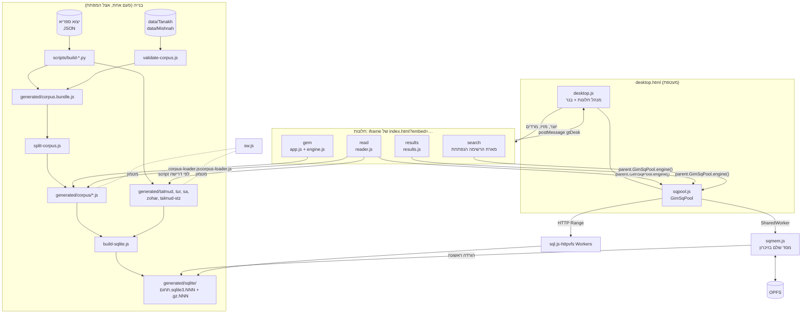
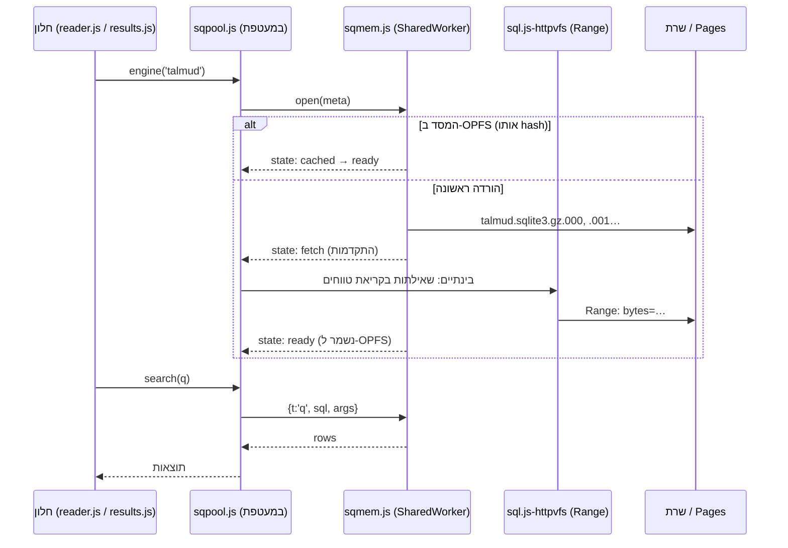
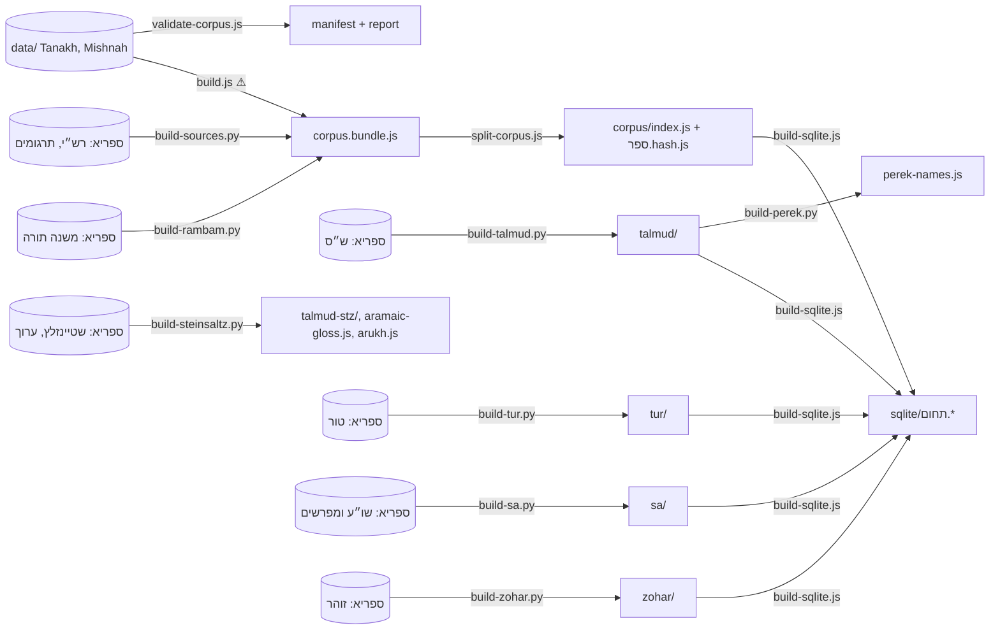

# ארכיטקטורה כללית של הקוד

המסמך מתאר איך גימטריבון בנוי: אילו קבצים יש, מה כל אחד עושה, איך הם מדברים זה עם זה, ואיך הנתונים זורמים מהמקור (ספריא) עד למסך.
על הקמת סביבה, Git, גרסאות ובדיקות ראו [מדריך למפתח](developer-setup.md).

> נכון לגרסה v4.17.3 (2026-11-02). ההסבר המפורט של כל מנגנון נמצא בהערה (בעברית) בראש הקובץ או הקטע הרלוונטי בקוד; המסמך הזה הוא המפה שמובילה אליהם.

---

## 1. עקרונות

- **אתר סטטי, בלי build לקוד.** Vanilla JS בתוך IIFE לכל קובץ, `'use strict'`, בלי מודולים ובלי bundler. קבצים מתקשרים דרך משתנים גלובליים על `window` (למשל `GematriaEngine`, `GimReaderCore`, `GimSq`, `GimSqPool`).
- **הנתונים הם קבצי script.** כל קובץ נתונים עושה השמה למשתנה גלובלי (`window.GIM_TP[...] = …`, `GimCorpus.put(...)`), ונטען בתגית `<script>` לפי דרישה. כך זה עובד גם ב-`file://` ובלי `fetch`. החריג היחיד הוא מסדי SQLite, שנקראים ב-Range או מורדים ל-OPFS.
- **אין רשת חיצונית בזמן ריצה**, מלבד שלושה בלוקים מבודדים ב-`app.js`: EmailJS (טופס "צור קשר"), Google Analytics, ו-`BUILDINFO` (שם הענף מ-`api.github.com`, רק במצב פיתוח). בדיקת `offline` ב-`tests/run-tests.js` אוכפת את זה.
- **מסך אחד, הרבה חלונות.** במחשב, `desktop.html` הוא מעטפת, וכל חלון הוא `iframe` של `index.html?embed=…`. אותו קוד מסכים משמש את שולחן העבודה, את ממשק הטלפון ואת הבדיקות.
- **עברית ו-RTL קודם.** אנגלית דרך מילון (`L()` ב-`app.js`, `T()` ב-`reader.js` וב-`desktop.js`).

---

## 2. מפת הקבצים

### 2.1 דפים

| קובץ | תפקיד |
|---|---|
| `index.html` | הדף של המסכים עצמם (גימטריה, קריאה, תוצאות). סקריפט קטן בראשו מחליט: עם `?embed=gem\|read\|search\|results` הוא רץ כתוכן של חלון; במחשב רחב בלי מגע הוא מפנה ל-`desktop.html`; במגע או ברוחב פחות מ-1000px, או עם `#phone`, הוא נשאר ממשק הטלפון. טוען את כל הסקריפטים שבסעיף 2.2 |
| `desktop.html` | מעטפת שולחן העבודה: בנר, פס משימות אנכי, משטח החלונות. טוען רק `sqlite-search.js`, `where-fit.js`, `sqpool.js`, `desktop.js` (עם `?v=<גרסה>`) |

### 2.2 קוד

| קובץ | שורות | תפקיד |
|---|---|---|
| `desktop.js` | ~1,160 | מנהל החלונות של שולחן העבודה: מצב, iframes, גרירה והצמדה, פס משימות, בנר משותף, היסטוריה לכל חלון, סימניות, שינה אוטומטית, מצב פיתוח |
| `app.js` | ~2,400 | מסך הגימטריה (שני צדדים, חיפוש בקורפוס, השוואה, נוטריקון, גלילה וירטואלית), ממשק הטלפון, שפה, מראה, סיור מודרך, חלונות מידע, מספר הגרסה ומצב פיתוח, רישום ה-Service Worker. חושף `window.GimApp` |
| `engine.js` | ~480 | מנוע הגימטריה הטהור (בלי DOM, UMD): נרמול, כל השיטות, השוואה כל-מול-כל, בניית אינדקס וחיפוש חלונות תיבות, נוטריקון. `window.GematriaEngine` / `module.exports` |
| `reader.js` | ~3,960 | מסך "קריאה ומפרשים": ליבה טהורה (`GimReaderCore`: אינדקס, ניתוח מראה-מקום, קיצורים) וממשק: כל סוגי הספרים, עימוד, חלוניות פירוש, זכוכית מגדלת, הדפסה, חיפוש (ישן ו-SQLite), מנוע חלון התוצאות, סרגל בחירת טקסט |
| `results.js` | ~250 | ממשק חלון "תוצאות חיפוש" (`?embed=results`): עץ סינון עם מונים, רשימה וירטואלית, מיון. המנוע עצמו ב-`reader.js` (`GimResults`) |
| `sqlite-search.js` | ~415 | מנוע החיפוש מעל SQLite FTS5: ניתוח שאילתה, נרמול, דירוג, הגדרת התחומים (`DOMAINS`). בלי DOM ובלי רשת; מקבל backend שמריץ SQL. משמש את הדפדפן, את הבדיקות ואת `build-sqlite.js` |
| `sqpool.js` | ~140 | חי בדף שולחן העבודה: מנוע חיפוש אחד לכל תחום, משותף לכל החלונות (`window.GimSqPool`). מנהל את Workers של קריאת הטווחים ואת החיבור ל-`sqmem.js` |
| `sqmem.js` | ~100 | SharedWorker לכל תחום (`gimsq-<תחום>`): מוריד את המסד הדחוס פעם אחת, מחזיק אותו בזיכרון של SQLite WASM, שומר ב-OPFS, ומשתחרר אחרי 5 דקות בלי שימוש |
| `corpus-loader.js` | ~70 | טעינת ספרי הקורפוס לפי דרישה (`window.GimCorpus`), עד 12 קבצים במקביל |
| `where-fit.js` | ~30 | קיצור שם המקום בכפתור בחירת הספר (שו״ע או״ח, ס׳…) כדי שייכנס. משותף לקורא ולבנר |
| `sw.js` | ~45 | Service Worker: מטמון לקובצי ספרים ולגופנים, רשת-קודם לקוד. לא נוגע ב-`generated/sqlite/`. לא נרשם ב-localhost וב-`file://` |
| `styles.css` / `desktop.css` | | עיצוב המסכים / עיצוב שולחן העבודה |

### 2.3 ספריות צד שלישי (`vendor/`, מקומיות)

| ספרייה | שימוש |
|---|---|
| `sql.js-httpvfs` | SQLite ב-Worker שקורא מסד בחלקים דרך HTTP Range (חיפוש לפני שהמסד בזיכרון) |
| `sqlite-wasm` (3.50.4) | SQLite רשמי ב-WASM עם FTS5, בתוך `sqmem.js` |
| `daf-renderer.js` (MIT) | פריסת "צורת הדף" של הגמרא |
| `driver.js` | הסיורים המודרכים |
| `fonts/` | Frank Ruhl Libre, Noto Rashi Hebrew, Stam Sefarad, Cormorant (OFL ורישיונות מצורפים) |

### 2.4 נתונים וסקריפטים

`data/` (מקור התנ״ך והמשנה), `generated/` (כל התוצרים), `scripts/` (בנייה). פירוט מלא בסעיף 7 כאן ובמדריך למפתח.

---

## 3. התמונה הכוללת

---

## 4. שולחן העבודה (`desktop.html` + `desktop.js`)

### 4.1 מודל החלונות

- **סוגי חלונות:** חלון גימטריה אחד תמיד קיים (`k:'gem'`); חלונות קריאה (`k:'read'`) וחלון תוצאות. סך חלונות הקריאה והתוצאות יחד מוגבל ל-`MAXW` (6).
- **כל חלון הוא iframe** של `index.html?embed=gem|read|results` (ו-`search` למארח נסתר של הרשימה הנפתחת). בתוך ה-iframe, `GT_EMBED` אומר ל-`reader.js` ול-`app.js` לא להציג את הכותרת הישנה ולא לעבור בין מסכים.
- **מצב:** האובייקט `D` (`{v, seq, act, z, last, sl, wins:[…]}`) נשמר ב-`localStorage['gimatrivonDesk']`. לכל חלון: מיקום וגודל, ממוזער/מוגדל, z-order, כותרת, ולחלון קריאה `hist` (עד 50 כתובות) ו-`hi` (המיקום בהיסטוריה). בביקור חוזר השולחן משוחזר, ורק החלון הפעיל נטען מיד.
- **`F` (Map):** לכל חלון פתוח: האלמנט, ה-iframe, ה-document וה-window שלו.

### 4.2 הבנר המשותף

הבנר (`#dkBan`) נמצא מחוץ לחלונות ומשקף את חלון הקריאה הפעיל: כפתור בחירת הספר, ניווט וכלים משוכפלים מתוך ה-iframe (`importNode`), וכל לחיצה מועברת לאלמנט המקורי בחלון. תיבת החיפוש `#dkQ` מעבירה את ההקלדה ל-`#rdQ` של חלון המארח. כפתור הטווח (`#dkScope`) בוחר "בספר / בפרק / בכל הספרים". כשחלון מוגדל, הפקדים שלו וחצי ההיסטוריה עוברים לבנר (`#dkWg`).
חלוניות שנפתחות מתוך הקורא (מעבר לפרק, תצוגה, הדפסה) "מורמות" לשכבה קבועה מתחת לבנר, כדי שלא ייחתכו בגבולות ה-iframe.

### 4.3 כתובות והיסטוריה לכל חלון

- מיקום בספר הוא hash: `#read/<אוסף>/<ספר>/<פרק>/<סעיף>`. למשל `#read/TN/Gen/1/5` (תנ״ך), `#read/MS/Ber/2/3` (משנה), `#read/MT/HD/7/4` (רמב״ם), `#read/TB/Ber/2b/3` (גמרא), `#read/TUR/OC/60` (טור; `/BY/3` או `/BH/3` לדיבור), `#read/TUR/SOC/1` (שולחן ערוך), `#read/ZH/Bereshit/15a/3` (זוהר). כתובות ישנות (`#read/Genesis/1/5`, `#read/Berakhot/2b`) עדיין נקראות. הניתוח ב-`reader.js` (`bookSlug`, `URL_COL`, `TN_AB`, `TRACT_URL`).
- `onHash(id)` ב-`desktop.js` מאזין לשינוי ה-hash בכל חלון ומנהל את `hist`/`hi`: מעבר בתוך אותו פרק מחליף את הרשומה, מעבר לפרק אחר מוסיף רשומה. `go(id, ±1)` הוא אחורה/קדימה.
- כתובת שולחן העבודה עצמו משקפת את החלון הפעיל (`syncUrl`), כך שאפשר לשתף קישור `desktop.html#read/…`.

### 4.4 תקשורת בין החלונות למעטפת

- **מהחלון למעטפת:** `parent.postMessage({gtDesk: …})`. הסוגים: `open` (פתח מקום בחלון קריאה), `res` (מצב חלון התוצאות), `results` (פתח חלון תוצאות לשאילתה), `gem` / `gemq` (שלח טקסט לגימטריה). הטיפול ב-`desktop.js` (קטע "מקלדת, מראה, שפה").
- **מהמעטפת לחלון:** גישה ישירה ל-DOM של ה-iframe (אותו מוצא), למשל לחיצה מועברת או `location.hash`.
- **שירותים משותפים:** חלון ניגש ל-`parent.GimSqPool` (ראו `sqShared` ב-`reader.js`), כך שיש מנוע חיפוש אחד לכל השולחן.

### 4.5 פעולות נוספות

סידור חלונות (במה, מדורג, זה לצד זה, רשת, מזער הכול, שולחן נקי), גרירה ושינוי גודל עם הצמדה, פס משימות אנכי בימין, סימניות (`gimatrivonMarks`, כפתור ☆ בפס החלון ובחלון המעבר), רקע השולחן, ומצב טלפון (5 לחיצות על הלוגו).

---

## 5. מסך הקריאה (`reader.js`)

### 5.1 מבנה הקובץ

1. **ליבה טהורה** (`GimReaderCore`, נבדקת ב-`run-tests.js`): נרמול לחיפוש, מספרים עבריים, אינדקס פרק/פסוק, שמות ספרים וקיצורים ("ש״א ג", "ב״מ נט:", "הל׳ ת״ת ג"), ניתוח מראה-מקום ושורת הקפיצה.
2. **ממשק** (רק בדפדפן, אחרי `app.js`): משתמש ב-`window.GimApp` לשפה, שמות ספרים ומעקב.

### 5.2 סוגי הספרים, מאיפה הנתונים ואיך מוצגים

| ספרים | נתונים | תצוגות |
|---|---|---|
| תנ״ך + רש״י, אונקלוס, יונתן | `generated/corpus/` (קטגוריות 0, 2, 3, 4) | "ספר" (ספר פתוח, תרגום בטור צד, מפרש בתחתית) ו"פסוק מול תרגום" |
| משנה + ברטנורא | `generated/corpus/` (1, 5) | ספר פתוח |
| משנה תורה לרמב״ם + כסף משנה, השגות הראב״ד, משנה למלך | `generated/corpus/` (7, 8, 9, 10) | שתי תצוגות (`ramView`: `book` / `aligned`) |
| ש״ס: גמרא, רש״י, תוספות, רשב״ם + ביאור שטיינזלץ | `generated/talmud/` (`GIM_TALMUD_INDEX`, `GIM_TP`), `generated/talmud-stz/` (`GIM_TS`) | "צורת הדף" (וילנא, `daf-renderer`) ו"גמרא ומפרשים"; שטיינזלץ שורה מול שורה |
| טור, בית יוסף, ב״ח | `generated/tur/` (`GIM_TUR_INDEX`, `GIM_TUR_P`) | עימוד בסגנון "שירת דבורה": הטור באמצע, ב״ח ובית יוסף מקיפים; עימוד במדידה, שלושה זרמים |
| שולחן ערוך (4 חלקים) + משנה ברורה, ביאור הלכה, כף החיים, ט״ז, ש״ך ועוד | `generated/sa/` (`GIM_SA_INDEX` וקובצי חלקים) | "דף מודפס" (טקסט למעלה, באר הגולה בצד, המפרשים בטורים למטה) ו"צורת דף" |
| זוהר + תרגום, הסולם | `generated/zohar/` (באותו מבנה כמו הגמרא, לפי עמודי וילנא) | ספר פתוח / דף מול תרגום / זוהר והסולם |

קטגוריות הקורפוס (`cat`): 0 תנ״ך, 1 משנה, 2 רש״י, 3 אונקלוס, 4 יונתן, 5 ברטנורא, 6 מילון, 7 רמב״ם, 8 כסף משנה, 9 השגות הראב״ד, 10 משנה למלך. ש״ס, טור, שו״ע וזוהר אינם בקורפוס; יש להם אינדקס וקובצי חלקים משלהם, שנטענים בתגית script רק כשפותחים את הספר.

### 5.3 קטעים מרכזיים בקובץ (לפי הכותרות בקוד)

ש״ס · זכוכית מגדלת (פס שנצמד לטור ומגדיל שורות) · טור · שולחן ערוך "דף מודפס" · הדפסה/PDF (שני עמודים לדף A4) · חלוניות · חיפוש מהיר (הישן, בזיכרון) · חיפוש SQLite בספר · חיפוש בכל הספרים · בנייה והסברי ריחוף · מעבר בין מצבים · סיור מודרך · מנוע חלון התוצאות · כלי בחירת טקסט (תרגום ארמי מ-`aramaic-gloss.js` ו-`arukh.js`, גימטריה, חיפוש, העתקה).

### 5.4 עימוד

תנ״ך, טור ושולחן ערוך מעומדים לפי מדידה אמיתית בדפדפן: מכניסים טקסט לעמוד עד שהוא מלא, ומפרש אף פעם לא מופיע לפני המקום שהוא מפרש. העמודים נשמרים במטמון לפי מפתח (`TMC`, `TPC`, `SBC`). כלל: אסור סרגל גלילה בתוך הספר (נבדק ב-`no-scrollbar.e2e.js`).

---

## 6. מסך הגימטריה (`app.js` + `engine.js`)

- **`engine.js`** הוא הליבה הטהורה: `normalizeText`/`tokens` (פונקציית נרמול אחת לכל דבר), `calculateGematria(text, method)` לכל השיטות (רגילה, כולל, תיבות, אותיות, מילוי, אתב״ש, אטב״ח והצירופים שלהן), `compareAll` (כל שיטה מול כל שיטה), `buildIndex`/`buildIndexAsync` (אינדקס של כל היחידות, נבנה בפרוסות כדי לא לחסום את המסך; טקסט ארוז בבית לתו כדי לחסוך זיכרון), ו-`search` (חלונות רצופים של תיבות בשיטת שני מצביעים, **לעולם לא חוצים יחידה**: פסוק, משנה, הלכה).
- **`app.js`** בונה את המסך: שני צדדים (א׳ ו-ב׳), לכל צד קלט, ערכי כל השיטות, סינון (שיטות, טווח, עץ מקורות, פרשות), תוצאות מהקורפוס והשוואה בין הצדדים. החיפוש מדורג (שיטה אחר שיטה עם הפסקות לדפדפן, וביטול כשמקלידים שוב). התוצאות נשמרות במאגר דחוס (13 בתים לשורה, עד 5 מיליון) ומוצגות בגלילה וירטואלית עם סקרולר מהיר.
- **הטעינה:** `corpus-loader.js` טוען קודם תנ״ך ומשנה ואחר כך השאר, והאינדקס נבנה תוך כדי.

---

## 7. חיפוש

יש שני מנועים, והחדש (SQLite) הוא העיקרי.

### 7.1 המנוע הישן (בזיכרון)

ב-`reader.js` (קטע "חיפוש מהיר"), על הטקסטים של הספר הפתוח שכבר נטענו. משמש בטלפון, ב-`file://`, ובכל כשל של SQLite.

### 7.2 SQLite FTS5 (`sqlite-search.js`)

- **מסד לכל תחום:** `tanakh`, `mishnah`, `rambam`, `talmud`, `tur`, `sa`, `zohar` (מוגדרים ב-`DOMAINS`). בכל מסד: טבלאות FTS5 בלי תוכן (`f0`, `f1`, `f2`…) לכל סוג מקור (טקסט, מפרש, תרגום), טבלאות `fts5vocab` (`v0`…) למיקומי מילים, וטבלה `d` עם הטקסט לתצוגה.
- **נרמול:** ארבע עמודות מיושרות מילה מול מילה: הצורה המקורית, כתיב מנורמל (חסר = מלא), בלי אות שימוש אחת, ובלי צירוף אותיות שימוש. כך "ארץ" מוצא גם "והארץ" בשאילתה אחת. אותו קוד משמש בבנייה ובחיפוש.
- **תחביר:** כל המילים (קרובות, עד 3 פסוקים), `"ביטוי"`, `בר*`, `^מילה`, `AND`/`OR`/`NOT`/`-מילה`, סוגריים, `NEAR`.
- **דירוג:** ביטוי רצוף, ואחריו כל המילים באותה יחידה לפי קרבה, ואחריו מילים ביחידות סמוכות. צורה מדויקת לפני צורה עם אות שימוש.
- **טווחים:** בספר, בפרק, בתחום, ו"בכל הספרים" (`sqSearchGlob`): אותה שאילתה נשלחת לכל התחומים במקביל, והתוצאות ממוזגות לפי דירוג; כל תחום מצטרף כשהוא מוכן.

### 7.3 איך המסד מגיע לדפדפן

- **`sqmem.js`** פועל כשיש SharedWorker, OPFS ו-DecompressionStream, ב-http(s), ובמחשב עם 4GB זיכרון ומעלה. הורדה אחת בכל פעם (Web Lock), התחומים הקטנים קודם. `localStorage.gimSqMem='0'` מבטל.
- **קריאת טווחים** (`sql.js-httpvfs`): כמה Workers לכל תחום, כל אחד עד 8MB של עמודים, `gimSqRcs` עמודים לבקשה. משמש עד שהמסד בזיכרון מוכן ובכל כשל. ל-`sa` ול-`zohar` אין קבצים לטווחים.
- **הרשימה הנפתחת** בבנר מוצגת מחלון מארח נסתר (`?embed=search`). "לכל התוצאות" פותח את **חלון התוצאות** (`?embed=results`, `results.js`) עם עץ סינון לפי תחום, ספר ומקור, 100 תוצאות בדף, וחלון "רזרבי" שמחומם מראש.

---

## 8. ממשק הטלפון

אין גרסת טלפון לשולחן העבודה. במגע או ברוחב פחות מ-1000px, `index.html` נשאר במסך המלא בלי חלונות: מעבר גימטריה/קריאה בכותרת, שורת סיכום לשני הצדדים, תפריט ⋮ (`mMenuPanel`), וגיליונות תחתונים. הקוד בתוך `app.js` (קטע "UX נייד: מעטפת-הטלפון (#mShell)") ו-`styles.css`. בטלפון החיפוש הוא המנוע הישן. לבדיקה במחשב: `index.html#phone`.

---

## 9. ניהול זיכרון

| מנגנון | איפה | מה עושה |
|---|---|---|
| טעינה לפי דרישה | `corpus-loader.js`, חלקי ש״ס/טור/שו״ע/זוהר | רק הספר הפתוח, המפרשים שלו והספרים הסמוכים |
| שינה אוטומטית | `desktop.js` (`autoSleep`, `sleepFrame`) | חלון שלא בשימוש משחרר את ה-iframe ונשאר עם "לחיצה להמשך". ברירת מחדל: גימטריה אחרי 10 דקות, קריאה ותוצאות אחרי 20; ממוזער אחרי 10. ניתן לשינוי בתפריט הסידור (0/5/10/30). החלון הפעיל לא נרדם |
| מזעור | `desktop.js` | שומר מצב קטן (מקום, היסטוריה, שדות) כך שאפשר לבנות את החלון מחדש |
| שחרור Workers של טווחים | `sqpool.js` (`IDLE` = 3 דקות) | Workers שלא נשאלו נסגרים ונפתחים שוב בבקשה הבאה |
| שחרור המסד בזיכרון | `sqmem.js` (`IDLE` = 5 דקות) | ה-SharedWorker נסגר (זיכרון WASM לא מתכווץ, רק סגירה משחררת). פתיחה מחדש מ-OPFS לוקחת כ-0.1–0.5 שניות |
| טקסט ארוז | `engine.js` (`packText`) | חצי זיכרון לטקסט באינדקס הגימטריה |

מדידות (2026-10-27): חלון הגימטריה במצב יציב תופס כ-85–100MB מעל בסיס של הדפדפן, עם שיא גבוה יותר בזמן בניית האינדקס; חלון קריאה כ-90MB; המסדים בזיכרון עד כ-400MB ביחד.

---

## 10. צינור הנתונים

עקרונות הפורמט:

- קבצים קטנים מ-~3MB (ספרים) או 32MB (מסדים), כי GitHub Pages חותך קבצים גדולים בלי שגיאה ו-GitHub מגביל ל-100MB.
- hash בשם הקובץ (בקורפוס) או במטא-דאטה (`<תחום>.js` של המסד), כדי שהדפדפן ישמור לתמיד ויוריד מחדש רק מה שהשתנה.
- סימוני עיצוב בתוך הטקסט בתווי בקרה: `\u0001…\u0002` מילה גדולה, `\u0003…\u0004` מודגש, `\u0005…\u0006` תרגום קצר / בדק הבית, `\u0010y3\u0011` עוגן של דיבור במפרש. הפירוט בראש כל סקריפט בנייה.
- הרישיון של כל מקור מתועד ב-`ATTRIBUTION.md` (ובקורפוס בשדה `lic`).

---

## 11. Service Worker ומטמון

`sw.js` (נרשם מ-`app.js` רק ב-http(s) שאינו localhost):

- קובצי ספרים עם hash וגופנים: תמיד מהמטמון.
- חלקי ש״ס, שטיינזלץ, טור, שו״ע, זוהר: מהמטמון מיד, ומתעדכנים ברקע.
- כל השאר (HTML, JS, CSS, `corpus/index.js`): רשת קודם, מטמון כשאין רשת. אחרי עדכון של `index.js` נמחקים מהמטמון ספרים שכבר לא ברשימה.
- `generated/sqlite/`: לא נוגע (טווחים ו-OPFS מטפלים בזה).

---

## 12. בדיקות

| קובץ | שכבה |
|---|---|
| `tests/run-tests.js` | יחידה: `engine.js`, ליבת `reader.js` (`GimReaderCore`), הקורפוס, ובדיקת offline סטטית על הקוד |
| `tests/sqlite-search.test.js`, `tests/sqlite-books.test.js` | `sqlite-search.js` מול המסדים הבנויים, דרך `node:sqlite` |
| `tests/*.e2e.js` | Playwright: כל קובץ מרים שרת http משלו ופותח `index.html?embed=…` או `desktop.html`. סיורים, אפשרויות התצוגה, חיפוש SQLite ברשת איטית, ורגרסיות ספציפיות |

הפירוט והכללים להרצה: [מדריך למפתח, סעיף 8](developer-setup.md#8-בדיקות).

---

## 13. איפה לשנות מה

| רוצים לשנות… | מתחילים ב… |
|---|---|
| שיטת גימטריה או הנרמול | `engine.js` (ו-`tests/run-tests.js`) |
| מסך הגימטריה | `app.js`, `styles.css` |
| תצוגה של סוג ספר | `reader.js`, בקטע של אותו ספר (סעיף 5.3) |
| קפיצה / קיצורי שמות / כתובות | ליבת `reader.js` (קיצורים, `bookSlug`, `TN_AB`, `TRACT_URL`) |
| חלונות, בנר, סימניות, שינה | `desktop.js`, `desktop.css` |
| תחביר או דירוג החיפוש | `sqlite-search.js` (ואם הנרמול משתנה: לבנות מחדש את המסדים) |
| טעינת המסדים, זיכרון | `sqpool.js`, `sqmem.js` |
| חלון התוצאות | `results.js` (ממשק), `reader.js` "חלון תוצאות חיפוש" (מנוע) |
| מקור טקסט חדש | סקריפט ב-`scripts/`, תחום ב-`sqlite-search.js` `DOMAINS`, טעינה ותצוגה ב-`reader.js`, שורה ב-`ATTRIBUTION.md`, ובדיקה ב-`sqlite-books.test.js` |
